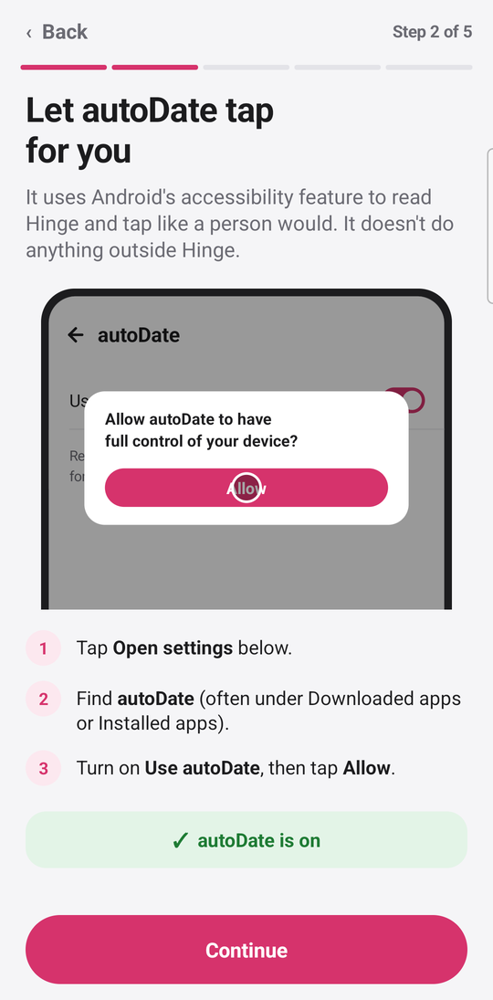
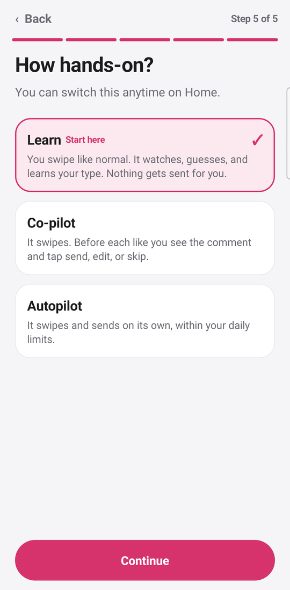

# Proxy Swiper

An Android app that swipes Hinge for you. It reads each profile, decides like or skip based on what you're looking for, picks the photo or prompt to like, and writes a short comment that sounds like you. Once someone replies, you take over.

this project has a low chance of being maintained because I hate the hinge app

<table>
  <tr>
    <td></td>
    <td></td>
    <td></td>
  </tr>
  <tr>
    <td></td>
    <td></td>
    <td></td>
  </tr>
</table>

It runs on your own phone. Android's accessibility service (the same thing screen readers and auto-clickers use) lets it read Hinge's screen and tap. An AI makes the calls: Claude, ChatGPT, Grok, or Kimi. A small proxy you run on your computer holds your AI access and your preferences, so none of that lives on the phone.

Hinge's terms don't allow automation, so the worst case is a permanent ban on your account and phone number. More in [RISKS.md](RISKS.md).

## What you need

- An Android phone on Android 11 or newer, with Hinge installed and logged in
- A computer with [Android Studio](https://developer.android.com/studio) and [Node](https://nodejs.org) 24
- An AI to do the judging. A subscription you already pay for is the cheap way to do it:
  - Claude: Claude Code on your Claude plan (the default)
  - ChatGPT: the Codex CLI on your ChatGPT plan
  - Or an API key for Anthropic, OpenAI, xAI (Grok), Moonshot (Kimi), or OpenRouter. This works but gets expensive fast, since every profile sends photos

## Install

**1. Run the proxy** on your computer:

```sh
git clone https://github.com/umich2021/proxy-swiper.git
cd proxy-swiper/proxy
npm install
npm install -g @anthropic-ai/claude-code && claude auth login   # if you're using Claude
npm run local
```

It prints a device token. Leave it running. For ChatGPT, Grok, or Kimi, set `BACKEND` in `proxy/.env.local` first; [proxy/README.md](proxy/README.md) has the table.

**2. Tell it about you.** The first run made three files in `proxy/config/`. Replace every `TEMPLATE` line, then restart `npm run local`:

- `preferences.json`: what you're looking for, your hard no's, how picky to be, your `city`, and `matches` (`women`, `men`, or `people`)
- `facts.json`: true stuff about you. Comments can only mention what's in here
- `voice_samples.md`: 10 to 20 real messages you've sent, exactly how you typed them

Git ignores these, so they stay yours.

**3. Install the app.** Turn on USB debugging on the phone, plug it in, open the `android/` folder in Android Studio, and press Run. Command line works too ([android/README.md](android/README.md)).

**4. Follow the setup guide.** The app opens one on first launch. It walks you through allowing restricted settings (Android 13+ blocks accessibility for sideloaded apps until you do), turning on accessibility, and connecting to the proxy. For the proxy link, use `http://<your computer's LAN IP>:8787` on the same Wi-Fi, or run `adb reverse tcp:8787 tcp:8787` and use `http://localhost:8787` over USB.

## Using it

Pick a mode on Home and tap the big button:

| Mode | What happens |
|---|---|
| Learn | You swipe like normal. It watches, guesses, and learns from what you actually do. Nothing gets sent for you |
| Co-pilot | It swipes. Before each like you see its comment and tap send, edit, or skip |
| Autopilot | It swipes and sends on its own, within your daily limits |
| Record | Debug only. Saves Hinge's screens so you can fix button matching |

Start in Learn for a few days. The History tab shows how often it agrees with you, and once that's high, try Co-pilot.

It also learns your physical type. The Review tab shows faces from profiles it saved, and you rate them 1 to 10. Only you see those ratings. It uses them to learn what you find attractive, on top of a general looks score and the minimum you set in `looks.min`. The more you rate, the better it gets.

While it runs, a floating bubble shows where it's at. Tap it or press volume-down to stop. It also stops at the daily like cap, when the session timer runs out, or when Hinge says you're out of likes. It takes over the screen while it runs, so start it when you're not using your phone, like while it charges.

Free Hinge gives about 8 likes a day, which is plenty to start.

## When something breaks

- **"Restricted setting" when you turn on accessibility.** App info → ⋮ → Allow restricted settings, then try again. The option only shows up after you've tried once.
- **The bubble is gone.** Accessibility got switched off, which some phones do after updates. Turn it back on. [android/README.md](android/README.md) has a one-time `adb` command that makes it come back by itself.
- **"Can't reach your proxy."** Is `npm run local` still running? Same Wi-Fi? Is the firewall letting port 8787 through?
- **"It rejected that token."** Copy the whole `DEVICE_TOKEN` from `proxy/.env.local`.
- **"Can't find the skip button" or "unknown screen."** Hinge changed its layout. [android/README.md](android/README.md) has the fix.
- **Samsung or Xiaomi keeps killing it.** Turn off battery optimization for Proxy Swiper. On Samsung, add it to Never sleeping apps.

## Changing it

How it judges and writes lives in `proxy/config/` and `proxy/src/prompts.ts`, and changing those only needs a proxy restart. The app is in `android/`. If you use Claude Code, `CLAUDE.md` has the repo rules, so you can open the repo and ask for changes.

## License

MIT. See [LICENSE](LICENSE).
