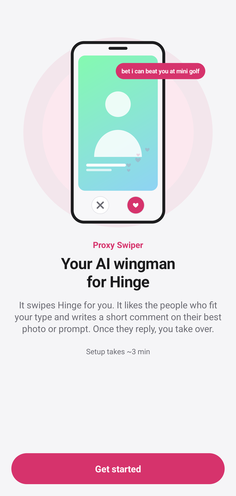
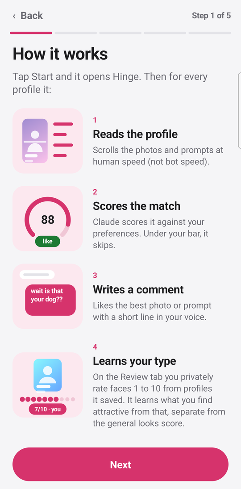
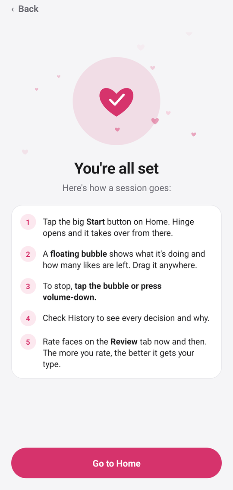
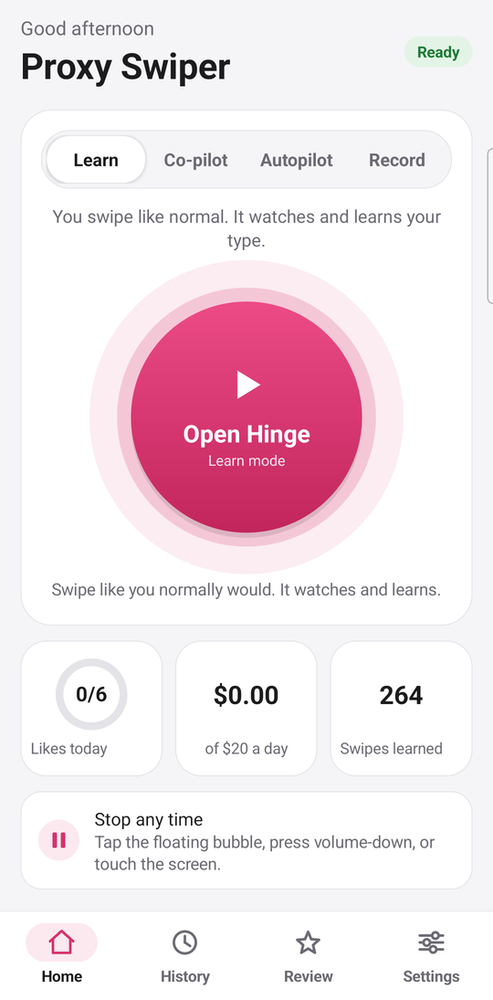

# autoDate

An Android app that swipes Hinge for you. It reads each profile, decides like or skip based on what you're looking for, picks the photo or prompt to like, and writes a short comment that sounds like you. Once someone replies, you take over.

<table>
  <tr>
    <td></td>
    <td></td>
    <td></td>
  </tr>
  <tr>
    <td></td>
    <td></td>
    <td></td>
  </tr>
</table>

It runs on your own phone. Android's accessibility service (the same thing screen readers and auto-clickers use) lets it read Hinge's screen and tap. Claude makes the calls. A small proxy you run yourself holds your Claude access and your preferences, so none of that lives on the phone.

Hinge's terms don't allow automation, so the worst case is a permanent ban on your account and phone number. More in [RISKS.md](RISKS.md).

## How the pieces fit

```
autoDate app (your phone)  --- HTTP(S) + device token --->  proxy (your PC, a server, or Cloudflare)  --->  Claude
reads Hinge, taps, asks                                      your preferences, the prompts, a daily $ cap
"like or skip?"
```

Everyone runs their own proxy with their own Claude access, preferences, and device token. Nothing here is tied to my account.

## What you need

- An Android phone on Android 11 or newer, with Hinge installed and logged in
- A computer with [Android Studio](https://developer.android.com/studio). It brings the JDK and installs the Android SDK on the first sync
- [Node](https://nodejs.org) 24 (that's what it's tested on)
- One way to reach Claude:
  - A Claude subscription plus Claude Code (`npm install -g @anthropic-ai/claude-code`). This is the default, and it costs nothing extra since it runs on your plan's limits
  - Or an Anthropic API key, paid per token
  - Or an OpenRouter key

## Install

### 1. Run the proxy

```sh
git clone https://github.com/umich2021/autodate-friends.git
cd autodate-friends/proxy
npm install
claude auth login   # once, only if you're using your Claude subscription
npm run local
```

The first run copies the templates from `proxy/config.example/` into `proxy/config/`, and writes `proxy/.env.local` with a random device token. It prints the token when it starts. Leave it running.

Using an API key? Put `BACKEND=api` and `ANTHROPIC_API_KEY=<your key>` in `proxy/.env.local` before you start it. Want it on without your computer? [proxy/README.md](proxy/README.md) covers Cloudflare and Docker.

### 2. Tell it about you

The AI only knows what's in these three files in `proxy/config/`. Git ignores them, so they stay yours. Replace every `TEMPLATE` line:

| File | What goes in it |
|---|---|
| `preferences.json` | What you're looking for, your hard no's, and how picky to be (`thresholds`, `looks.min`). `city` is where suggested dates happen. `matches` is `women`, `men`, or `people` and sets the pronouns in the prompts |
| `facts.json` | True stuff about you. Comments can only mention what's in here, so leave out anything you don't want said |
| `voice_samples.md` | 10 to 20 real messages you've sent, exactly how you typed them |

Restart `npm run local` after you edit them. You don't need to rebuild the app.

### 3. Install the app

On the phone, turn on USB debugging (Settings → About phone → tap Build number 7 times, then Developer options → USB debugging). Plug it in, then either:

- Open the `android/` folder in Android Studio, wait for the Gradle sync, and press Run
- Or from the command line, with `ANDROID_HOME` set to your Android SDK and a JDK on your PATH (Android Studio's works):
  ```sh
  cd android
  ./gradlew installDebug
  ```

### 4. Point the app at your proxy

The app opens a setup guide the first time. On its Connect step, paste your proxy link and the device token. Which link depends on where the proxy runs:

| Proxy runs on | Link to paste |
|---|---|
| Your computer, phone on the same Wi-Fi | `http://<your computer's LAN IP>:8787`. On Windows, allow port 8787 through the firewall |
| Your computer, phone on USB | Run `adb reverse tcp:8787 tcp:8787`, then use `http://localhost:8787` |
| Your computer, phone somewhere else | Put Tailscale on both and use the computer's Tailscale IP |
| Cloudflare or your own server | Its https link |

The rest of the guide covers allowing restricted settings (Android 13+ blocks accessibility for sideloaded apps until you do), turning on the accessibility service, and notifications. You can replay it any time from Settings → App.

Optional: Android sometimes switches accessibility off after an app update. Run this once and the app turns it back on by itself:

```sh
adb shell pm grant com.autodate.app android.permission.WRITE_SECURE_SETTINGS
```

## Using it

Pick a mode on Home and tap the big button:

| Mode | What happens |
|---|---|
| Learn | You swipe like normal. It watches, guesses, and learns from what you actually do. Nothing gets sent for you |
| Co-pilot | It swipes. Before each like you see its comment and tap send, edit, or skip |
| Autopilot | It swipes and sends on its own, within your daily limits |
| Record | Debug only. Saves Hinge's screens when you tap the REC bubble, for fixing button matching |

Start in Learn for a few days. The History tab shows how often it agrees with you, and once that's high, try Co-pilot.

While it runs, a floating bubble shows where it's at ("Profile 14 · 5/8 likes · $0.31"). Tap it or press volume-down to stop. It also stops by itself at the daily like cap, when the session timer runs out, or when Hinge says you're out of likes. New matches get an opener and you get a notification to take it from there.

It takes over the screen while it runs (Android can only tap what's actually on screen), so run it when you're not using your phone. Charging on the nightstand works.

Free Hinge gives about 8 likes a day, which is plenty to start. On a Claude subscription the proxy costs nothing extra. On an API key, the daily cap (`MAX_DAILY_USD`, $5 by default when run locally, changeable from the app) limits what a day can spend. [COST.md](COST.md) has the math.

## When something breaks

- **"Restricted setting" when you turn on accessibility.** App info → ⋮ → Allow restricted settings, then try again. The menu item only shows up after you've tried once.
- **The bubble is gone.** Accessibility got switched off, which some phones do after updates. Turn it back on, or do the `adb` grant above.
- **"Can't reach your proxy."** Is `npm run local` still running? Same Wi-Fi? Is the firewall letting 8787 through?
- **"It rejected that token."** Copy the whole `DEVICE_TOKEN` from `proxy/.env.local`.
- **"Can't find the skip button" or "unknown screen."** Hinge probably changed its layout. Switch to Record, tap the REC bubble on the screen that broke, then Settings → Data → Export data to Downloads. `python3 tools/summarize_dumps.py <export>.zip` shows what Hinge exposes now. The matching rules are in `android/app/src/main/assets/selectors.json`. Exports have other people's profiles in them, so don't commit them or attach them to issues.
- **Samsung or Xiaomi keeps killing it.** [TECH.md](TECH.md) §9 has the battery settings to change.

## Changing it

| Folder | What's there |
|---|---|
| `android/` | The Kotlin app. The accessibility service and session logic are in `agent/`, screen reading in `screen/`, the overlay and animations in `ui/`, plus `MainActivity` and `OnboardingActivity` |
| `proxy/` | The TypeScript proxy. Prompts in `src/prompts.ts`, judging in `src/brain.ts`, the message checks (length, no links, no repeats) in `src/validate.ts` |
| `evals/` | `run_eval.py` scores the AI against your own swipes from an export |
| `tools/` | `summarize_dumps.py` reads Record mode exports |

Most tweaks to how picky it is or how it writes are in `proxy/config/` or `src/prompts.ts`, and those only need a proxy restart. If you're using Claude Code, `CLAUDE.md` has the repo rules (like bumping `appVersion` with every app change), so you can open the repo and just ask.

## What it won't do

- Hold conversations past the first message. That part's on you
- Run while you use other apps (one phone, one screen)
- iPhone. iOS doesn't allow this kind of app
- Play Store. It's sideload only

## Why it's built this way

| Decision | Choice | Why |
|---|---|---|
| Device | Your real Android phone | Passes device integrity checks, normal location, no emulator rabbit hole, no one-login-at-a-time problem |
| Control | `AccessibilityService`: read the view tree, `dispatchGesture`, `takeScreenshot` | No root, no USB debugging, no PC needed once it's set up |
| Language | Kotlin, minSdk 30 (Android 11+) | `takeScreenshot()` needs API 30 |
| Brain | Claude Opus 5.5 (`claude-opus-5-5`), optional Claude Haiku 5.5 pre-filter | Good at reading photos and judging. The pre-filter roughly halves the cost |
| Keys | A small proxy you run | Your key stays off the phone, and the server enforces the daily $ cap |
| Approvals | A card drawn over Hinge with send / edit / skip | You're looking at the phone anyway in Co-pilot |
| Storage | SQLite on the phone | One user, stays private |
| Rollout | Learn → Co-pilot → Autopilot | Catch bad behavior before it costs you the account |

## Docs

| File | What's in it |
|---|---|
| [proxy/README.md](proxy/README.md) | Running the proxy on your PC, a server, or Cloudflare; endpoints; cost reports |
| [android/README.md](android/README.md) | Building the app, first-time setup, how a session stops |
| [TECH.md](TECH.md) | App architecture, accessibility layer, gestures, LLM pipeline, proxy, data model |
| [COST.md](COST.md) | Monthly costs, token math |
| [PREFERENCES.md](PREFERENCES.md) | How preferences are written, scored, and learned, plus the comment-writing rules |
| [ROADMAP.md](ROADMAP.md) | Phased build plan with exit criteria |
| [RISKS.md](RISKS.md) | ToS, detection, ethics, privacy, prompt injection, things that can go wrong on the phone |

## License

MIT. See [LICENSE](LICENSE).
